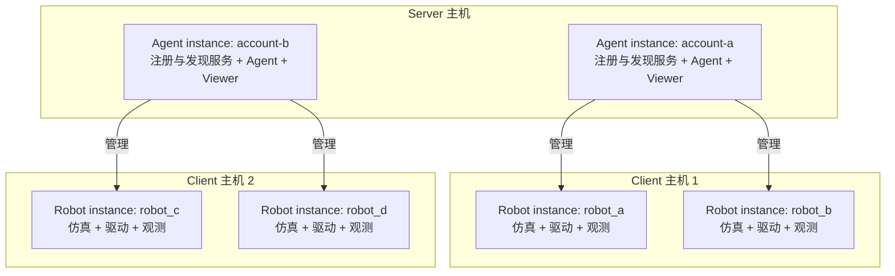

# AgenticROS

让 Codex 通过 ROS 2 发现机器人、读取观测并调用能力。提供 `cartesian_gripper` 单夹爪测试台和 `aloha_tabletop` 双臂桌面环境，可在浏览器中查看画面。

支持 **Linux 和 macOS**，宿主机只需 **Docker（含 Compose）和 Python 3**，无需安装 ROS。

## 主机与实例

| 层级 | Server 端 | Client 端 |
| --- | --- | --- |
| 主机（电脑） | **Server 主机**：运行 Agent instance | **Client 主机**：运行 Robot instance |
| 实例（当前为容器） | **Agent instance**：注册与发现服务 + Agent + Viewer | **Robot instance**：仿真或真实机器人接口 + 驱动 + 观测 |

当前实现的是仿真 Robot instance，真实机器人接口尚未支持。



一台主机可以运行多个实例，一个 Agent instance 可以管理多个 Robot instance。
**Server 和 Client 是主机角色，可以由同一台电脑承担**；不同电脑需在可互通的局域网内。图中只是部署示例，Robot instance 可加入任一 Agent instance。

首次使用只需一个 Agent instance 和一个 Robot instance。

## 快速开始

**先启动 Agent instance → 获取连接码 → 启动 Robot instance → 在 Codex 中下达指令。**

每台参与的电脑准备相同版本的本仓库，启动 Docker，以下命令均在仓库根目录执行。首次启动会构建缺少的镜像，需要联网并等待完成。

**macOS 额外设置一次：**使用 Docker Desktop 4.34+，在 **Settings → Resources → Network** 开启 **Enable host networking**，然后 **Apply & restart**。该功能不能与 Enhanced Container Isolation 同时使用。

### 1. 启动 Agent instance

在 Server 主机上执行：

```bash
bash scripts/agent.sh --agent_id account-a
```

按终端菜单登录 ChatGPT 账号或配置 API。脚本会打印 **join码、Viewer 地址和访问密码**。

### 2. 启动 Robot instance

在 Client 主机上（同机部署时另开终端），执行下面的命令，将 `CONNECTION_CODE` 替换为上一步输出的 join码：

```bash
bash scripts/robot.sh cartesian_gripper --robot-id robot_a --join CONNECTION_CODE
```

将 `CONNECTION_CODE` 替换为完整连接码。连接码已包含 Server 主机地址，**不用再传 IP**；只交给需要加入的 Client 主机操作者。

需要第二个 Robot instance 时，使用相同连接码，把 `robot_a` 改为 `robot_b` 即可。

### 3. 查看画面并开始使用

打开 Agent instance 输出的 Viewer 地址，输入密码，在顶部选择机器人查看 RViz2 画面。默认在 Server 主机浏览器打开。点击 **ROS interfaces** 可查看 Topics、Services 和 Actions。

在 Codex 会话中输入：

```text
发现并适配 robot_a，核对身份和 session，报告可用能力。
```

适配完成后，可以尝试仿真任务：

```text
把红色方块夹取到红色盘子上。
```

## 常用操作

用户入口按对象命名：`agent.sh` 启动 Agent，`robot.sh` 启动 Robot，`agent-login.sh` 单独登录 Agent，`delete-agent.sh` 删除旧单机 Agent 实例，`clean-runtime.sh` 清理整个项目的运行数据。
原 `agenticros.sh`、`environment.sh`、`docker-login.sh`、`delete-instance.sh` 已改名；重复入口 `docker-chat.sh` 已移除。
`agent-options.sh` 是供入口脚本加载的内部参数解析文件，不是启动命令。

新实例的运行目录按归属保存：

```text
runs/
  agent_instances/<agent_id>/
    lan/                       # 注册配置、Viewer 配置
    workspace/                 # Agent 生成的代码、证据、适配器
  robot_instances/<agent_id>/<robot_id>/
    client.json                # 环境与 Agent 绑定配置
    observations/              # 图像、深度与快照
  checks/<run_id>/             # 维护者测试结果
```

Agent 登录状态和会话历史仍在其专用 Docker 数据卷中。`--agent_id` 是新的正式参数，`--instance` 保留为兼容别名。
已有实例会继续使用旧目录和旧观测卷，不会在线搬动正在运行的工作区；完整清理后重新启动即使用上述目录。

**清理所有本项目运行产物**（不会自动执行）：

```bash
bash scripts/clean-runtime.sh                 # 只预览删除清单
bash scripts/clean-runtime.sh --yes           # 停止并移除容器，删除数据卷、整个 runs/ 和 Python 缓存
bash scripts/clean-runtime.sh --yes --images  # 另外删除本项目镜像标签
```

`--yes` 会删除登录状态、会话历史、适配器、观测和测试证据，正在运行的本项目任务也会停止。
清理范围为本仓库挂载/Compose 资源及 `agenticros-`、`agenticros_`、历史 `rosbody-`、`rosbody_` 命名空间。
源码、Git 历史及其他 Docker 项目保留；不执行全局 prune，共享 Docker 构建缓存保留。

命令中的 `--agent_id account-a` 指 **Agent instance**，`--robot-id robot_a` 标识该 Agent instance 下的 **Robot instance**。`lan.py robot` 是管理 Robot instance 的现有子命令。

**查看连接状态、重新显示 join码和 Viewer 信息**（在 Server 主机上）：

```bash
python3 scripts/lan.py status --agent_id account-a
python3 scripts/lan.py info --agent_id account-a
```

**下次继续使用**：先在 Server 主机恢复会话，再在 Client 主机恢复 Robot instance，无需重新输入连接码。

```bash
# Server 主机
bash scripts/agent.sh --agent_id account-a resume --last
# Client 主机
bash scripts/robot.sh cartesian_gripper --agent_id account-a --robot-id robot_a
```

Robot instance 重启会重置仿真场景，继续任务前让 Codex 重新发现并核对 session。

**停止运行**：先结束 Codex 中的任务，再停止各 Robot instance，最后停止 Agent instance。

```bash
# 在各 Client 主机上执行
python3 scripts/lan.py robot --agent_id account-a --robot-id robot_a --stop
# 在 Server 主机上执行
python3 scripts/lan.py stop-agent --agent_id account-a
```

退出 Codex 不会停止容器；上述停止命令保留账号、配置和工作文件。

## 更多说明

- [详细使用说明](docs/usage.md)：多账号、指定 IP、镜像升级、远程查看画面和旧版迁移。**更新源码后，已有镜像需要手动重建。**
- [开发记录](docs/development-record.md)：Docker 目录结构、架构、测试与验证历史。

当前面向可信局域网中的仿真，不用于公网或物理机器人。已完成 macOS 同机和独立容器 IP 的集成验证，真实 Mac ↔ Linux 双机验收仍待完成。

## 双臂桌面环境

```bash
bash scripts/agent.sh --agent_id aloha-demo
bash scripts/robot.sh aloha_tabletop --join CONNECTION_CODE --robot-id aloha_a
```

一个 `aloha_tabletop` Robot instance 包含同一物理世界里的两臂，不能把左右臂作为两个独立实例启动。
左右臂接口位于该机器人 session 名称空间下的 `left/driver/`、`right/driver/`，共用坐标系与物理时钟。
三路相机使用 RViz 内置 Image 面板显示，默认按左腕、俯视、右腕排列，并保留点云视图。腕部相机随对应机械臂移动。
模型使用 MuJoCo Menagerie ALOHA 2，固定来源和许可见 `docker/robot_instances/aloha_tabletop/model/UPSTREAM`。
目前提供关节位置伺服、`move_pose`、`move_delta`、RGB-D、完整 TCP 位姿、动作取消和回执。
两臂的笛卡尔动作均支持 `base` 和起始 `tcp` 参考系，包含局部数值 IK、路径预检与末端误差验证；不包含碰撞检测或自动绕障。
`move_pose(base)` 是绝对位姿，`move_pose(tcp)` 是相对于起始 TCP 的目标；`move_delta` 按指定坐标轴施加平移与绕 TCP 原点的旋转增量。
姿态使用四元数 xyzw，长度用米，成功容差为 3 mm / 0.03 rad。接口及限制通过运行时 `device_documentation` 和 `interface_sources` 参数公开。
这不表示已验证自主抓放或真实机器人；独立评估器目前仅判定红块放入红盘。

旧环境已经正式改名为 `cartesian_gripper`，旧 `simple_mujoco` 命令不再支持。
已有账号、工作区和数据卷保留；新环境使用新的 `--robot-id`，避免改变已有实例的环境绑定。

### 主 agent 与执行子 agent（实验配置）

主会话按 `AGENTS.md` 分配每个臂的子目标，并继续观测和协调；`arm-executor` 自定义子 agent 负责单臂闭环执行。
角色文件在启动时复制到 `/workspace/.codex/agents/arm-executor.toml`。启动或恢复节点不会自动恢复运动。
用户下达仿真任务即包含范围内的能力开发、分阶段试验和失败恢复。主 agent 先发现接口并建立执行反馈，再协调各臂开发与运动，无需用户逐步批准；缺少现成能力时应继续实现和验证。
交接可先尝试一臂保持、另一臂接取的顺序策略；确实需要同步控制时再开发联合 ROS 能力。角色配置不包含完整任务脚本；ALOHA 的基础笛卡尔运动由环境提供。
分配归属目前由协作协议约束，驱动只强制每臂一个在执行的 action；尚无跨 agent 的控制权限强制隔离。
双臂自主任务成功、监督响应延迟和异常恢复效果仍须单独验收，不能用 ROS 集成测试结果替代。
