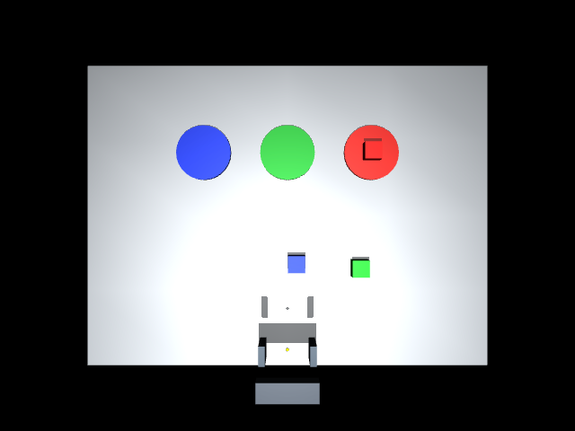

# ROSBody

**A ROS-native body interface for coding agents.**

A minimal simulation-first prototype: a coding agent reads `setup_body.md`, observes a
MuJoCo scene through ROS 2, writes short Python programs, and operates a physical-contact
parallel gripper through bounded ROS Actions.

This first body is a **three-axis Cartesian manipulator**, with fixed downward orientation.
It is not a six-axis arm. The scene has red/blue/green cubes and matching circular plates.
No model API key is required to run the simulator or diagnostic scripts.

## Architecture

```text
Codex / another coding agent
    │ body instructions + Python programs + image inspection
    ▼
rosbody.client.Robot (rclpy)
    │ ROS 2 Services / Actions / sensor topics
    ▼
ROSBody server — one active action, measured receipts, immutable snapshots
    ▼
MuJoCo — position servos, gripper contact and friction
```

The agent runtime is external. ROSBody does not contain a second LLM planning loop.
Robot state remains in the server between programs. Python variables do not persist between
client processes. Generated helpers can persist as files.

## Quick start (Apple Silicon Mac)

Install [Pixi](https://pixi.sh), then from this repository:

```bash
pixi install
pixi run build
pixi run server
```

Alternatively use a ROS launch description (headless):

```bash
pixi run bash -c 'source scripts/ros_env.sh; ros2 launch ./launch/sim.launch.py seed:=3'
```

A separate terminal, same directory:

```bash
pixi run bash scripts/client.sh status
pixi run bash scripts/client.sh snapshot
pixi run bash -c 'source scripts/ros_env.sh; python examples/pick_place.py'
```

The last command performs a **deterministic RGB-D diagnostic**, not an autonomous Codex trial.
It uses image colour components and metric depth, not simulator object coordinates.
Inspect the final RGB path printed by the program. The server's separate `evaluator.json`
records the hidden ground-truth check for development; do not expose it to task agents.

For a visible simulation window on macOS:

```bash
pixi run bash -c 'source scripts/ros_env.sh; mjpython -m rosbody.server --viewer'
```

Use only one server at a time. `Ctrl-C` stops a headless server; close the viewer for a viewer run.
A headless run still renders RGB-D through an offscreen OpenGL context (on Mac, run in a graphical login session).
For Linux rendering, a working OpenGL backend is needed; `MUJOCO_GL=egl` is an option on suitable GPU hosts.
The Linux dependency target is included but must be validated on a Linux host.

The environment uses RoboStack ROS 2 Jazzy. Pixi locks the dependency versions.
Custom action/service definitions are built by `colcon`; remember to source `scripts/ros_env.sh`
inside the Pixi environment. No system ROS installation is needed.

## Give the body to Codex

Open this repository in Codex and give a task such as:

> Read setup_body.md. Check the local simulation is ready. Use fresh RGB-D observations to
> put the red cube on the red plate. Write and run stage programs, inspect images between
> visually dependent stages, and recover from a failed grasp. Do not read evaluator truth
> or copy the diagnostic example's task plan.

`AGENTS.md` points to the body contract; `.agents/skills/setup-body/SKILL.md` provides a
reusable skill entry point. Shell/Python access and local image reading suffice; MCP is optional.
Run commands through `pixi run` so ROS dependencies and generated interfaces are available.
This repository does not provision model authentication or bypass the agent's permissions.

## Interfaces

| Endpoint | Type | Purpose |
|---|---|---|
| `/body/move_free` | `rosbody_interfaces/action/Move` | Fixed-orientation grasp-center xyz in base metres |
| `/body/gripper` | `rosbody_interfaces/action/Gripper` | Inner finger width in metres |
| `/body/capture_snapshot` | `rosbody_interfaces/srv/Snapshot` | Immutable RGB/depth/calibration/state bundle |
| `/body/status` | `std_srvs/srv/Trigger` | Measured state, session, busy flag, completed receipts |
| `/sim/reset` | `std_srvs/srv/Trigger` | Reset only when no action is running |
| `/camera/front/{rgb,depth,camera_info}` | sensor topics | 640×480 RGB-D, reliable QoS (depth 2) for cameras; sensor-data QoS for joints |
| `/joint_states`, `/tf` | state topics | Cartesian/parallel-gripper joints and optical transform |

See [setup_body.md](setup_body.md) for conventions, recovery and usage examples.

## Verification

```bash
pixi run test
pixi run bash -c 'source scripts/ros_env.sh; python examples/verify_ros.py'
```

The second command requires the running server and exercises ROS transport, concurrent-goal
rejection, invalid targets, cancellation, and image topic publication. It resets the simulation.
The physical-contact test and RGB-D tests can also run without ROS if Python dependencies are installed.

## Verified locally

On 2026-11-13, Apple Silicon macOS 26.6, ROS 2 Jazzy, Python 3.12.16 and MuJoCo 3.17.0:

- Custom ROS interfaces compiled successfully.
- 10 physics/observation tests passed.
- 9 live ROS integration checks passed, including cancellation, goal exclusivity and timeout reconciliation without replay.
- The RGB-D diagnostic completed red-cube-to-red-plate placement through ROS, at randomized seed 3; the separate evaluator reported success.
- Final RGB was visually inspected. This is one diagnostic rollout, not a success-rate benchmark or an autonomous LLM evaluation.
- Launch-description argument loading was checked; the interactive viewer path has not yet been exercised in this run.



## Scope and limitations

- Simulation only. No hardware driver or real robot motion.
- Stepped time: physics advances during actions, pauses while reasoning. No real-time claim.
- Straight-line Cartesian motion; workspace limits, but no general collision-free planner.
- Three coloured cubes and flat plates; initial perception assumes separate regions and known size ordering.
- No SAM3, Jev, VLA, learned planner, or automatic skill promotion yet.
- ROS cancellation is cooperative; stop confirmation is derived from simulated measured velocities.
- Receipts are cached in memory and journaled to disk. Restart recovery is not implemented;
  a missing result after restart remains unknown. Actions are never automatically replayed.
- Agent and server share a local filesystem for images; remote artifact transport is not implemented.
- Evaluator separation is a convention, not an OS sandbox. An unrestricted coding agent can read local source.

## Layout

```text
rosbody/assets/tabletop.xml MuJoCo body and scene
src/rosbody_interfaces/     ROS Action/Service definitions
rosbody/sim.py              physics, observations, evaluator-only checks
rosbody/server.py           ROS bridge and action admission
rosbody/client.py           blocking client, no automatic action retry
rosbody/perception.py       RGB-D colour-component baseline
setup_body.md               agent-facing body contract
examples/                  developer diagnostics
runs/                      ignored runtime observations and receipts
```
