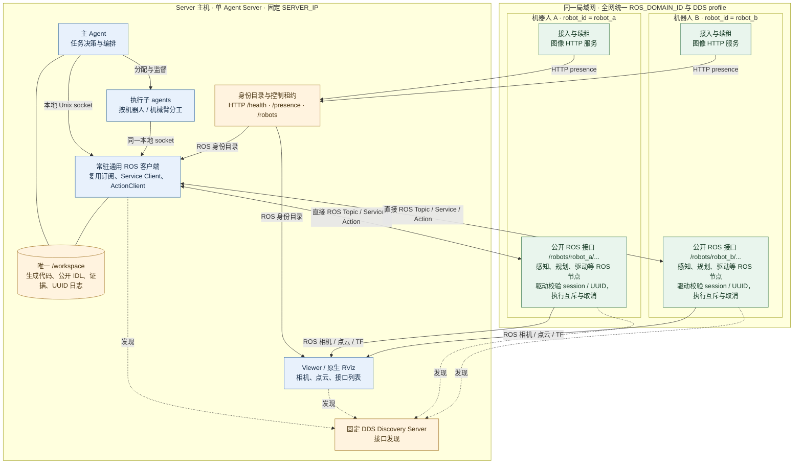

# AgenticROS

一个 Agent Server，在同一局域网接入多台机器人。Server 内一个监督 Agent 可使用多个执行子 agent；感知、规划、驱动仍可由多个 ROS 节点实现。当前仓库提供 Cartesian Gripper 和 ALOHA 双臂共享世界仿真，不包含真实硬件部署验证。

## 系统架构



- 虚线表示 DDS 发现关系；动作、状态和观测通过公开 ROS 接口直接传输，Discovery Server 不转发动作。图中的身份目录与 Discovery Server 是逻辑职责，当前由同一个 registry 进程承载。
- HTTP presence 负责身份与控制租约，不代表 ROS 接口已可调用。快照服务返回的图像 URL，由 Agent 侧按需通过 HTTP 下载并校验；RViz 相机走 ROS topic。
- 接口名称空间固定，机器人重启改变 `session_id`；状态、动作请求及回执携带 session。ALOHA 的左右臂属于同一机器人，共享世界和 session，接口在该 robot_id 下继续按臂划分。
- 启动 Agent 前同步 AGENTS.md、contract、skills 和执行子 agent 规则到工作区，无需因提示词更新重建镜像。


Server 同时提供原生 RViz、相机面板和只读接口列表。机器人进程内保留 session 校验、动作 UUID、单臂互斥、取消和停止回执。等待超时不自动重发。客户端和 Server 不预装设备任务程序；Agent 从运行时公开接口获取设备文档和 IDL，按需实现能力。

## 启动

依赖 Docker、Docker Compose、Python 3。Linux 使用 host 网络；macOS 使用 Docker Desktop 4.34+，开启 Settings → Resources → Network → Enable host networking，关闭 Enhanced Container Isolation。默认全网 TCP Discovery Server；同机测试不能证明跨机器 LAN 可用。

先确认 **Server 主机在同一局域网中的 IPv4 地址**：macOS 可在“系统设置 → 网络”中查看当前连接的 IP；Linux 可用 `ip -4 addr` 查看实际联网网卡。选择机器人能访问的宿主机地址，不使用 `127.0.0.1` 或 Docker 容器/虚拟机内部地址。下面的 `192.168.1.10` 仅为示例，请替换为实际地址；建议用静态 IP 或路由器 DHCP 地址保留，避免地址变化。

Server 主机：

```bash
export SERVER_IP=192.168.1.10  # 替换为 Server 主机的实际局域网 IP
python3 scripts/lan.py server --host "$SERVER_IP"
bash scripts/agent.sh
# 登录或恢复会话
bash scripts/agent-login.sh
bash scripts/agent.sh resume --last
```

机器人主机（每台主机的终端都需设置同一个 `SERVER_IP`，这里填 Server 的地址；`robot_id` 全网唯一）：

```bash
export SERVER_IP=192.168.1.10  # 与 Server 主机上设置的地址一致
bash scripts/robot.sh aloha_tabletop --server "http://${SERVER_IP}:7447" --robot-id aloha_a
bash scripts/robot.sh cartesian_gripper --server "http://${SERVER_IP}:7447" --robot-id gripper_b
```

同一主机运行多台机器人时，第二台显式指定不同的 `--observation-port 8801`。不生成 join 码，不分配 Agent instance，不动态分配 ROS 域。`--host` 可显式指定机器人向 Server 公布的 IPv4 地址。

首次启动会保存 Server 和机器人配置。之后仅修改终端中的 `SERVER_IP` 不会覆盖保存的地址；IP 变化时，先停止相关任务和服务，再按[使用说明](docs/usage.md)更新 `runs/server.json` 及机器人各自的 `client.json`，重新启动接入。

重复运行使用保存配置，不重建镜像、不替换运行中的容器、不清空工作区。首次缺镜像时构建。升级代码的显式构建与停止步骤见[使用说明](docs/usage.md)。退出 Agent 终端不停止 Server、机器人或 RViz。

```bash
python3 scripts/lan.py status
python3 scripts/lan.py info
python3 scripts/lan.py stop-viewer
python3 scripts/lan.py viewer
python3 scripts/lan.py robot --robot-id aloha_a --stop
python3 scripts/lan.py stop-server
```

Viewer 默认 `http://127.0.0.1:8080/vnc.html`。通过 `python3 scripts/lan.py info` 查看地址、`python3 scripts/lan.py viewer-password` 查看口令；口令保存在专用 `viewer-auth` 卷中。Server 管理命令会加载 `runs/server.json`。

## 状态与安全语义

| 信号 | 证明什么 |
| --- | --- |
| `process_alive` | 近期 HTTP presence 或新鲜 ROS 状态证明进程存活；无证据为未知，不证明进程死亡 |
| `control_lease_valid` | 唯一 robot_id 的控制租约尚有效；超时会停止动作并锁住控制 |
| `ros_discoverable` | ROS 图已发现该机器人接口；可能包含尚未清除的旧端点 |
| `service_callable` | 按端点记录实际 RPC 响应、时间与服务端成功标志；未调用为无证据 |
| `observation_fresh` | 收到匹配当前 session 的新鲜状态样本；图像时间须单独核对 |
| `control_available` | 按状态端点分别报告新鲜度、租约、驱动空闲/故障条件；未出现的臂为未知，驱动最终裁决动作 |

HTTP `/presence` 合并首次身份申请和续租，仅负责唯一身份/控制许可；`/health` 提供固定网络配置，`/robots` 提供身份目录。该目录同时通过 ROS 发布，Viewer 和常驻客户端复用订阅。服务端重启或租约过期不自动恢复控制，需明确重启对应机器人并取得新 session。接口名称保持稳定。

此方案面向可信同一局域网；去掉 join 码后 HTTP 身份租约不提供客户端身份认证，DDS 也未启用 SROS2。不能把唯一 robot_id 的租约当作安全认证或物理机器人权限隔离。

## 数据与规则

- 唯一工作区：`runs/workspace/`，保存生成代码、IDL、证据、能力清单及动作发送日志。
- Server 配置：`runs/server.json`；机器人配置/图像：`runs/robots/<robot_id>/`。
- 账号：默认沿用 `agenticros_codex-home`；Viewer 口令默认沿用 `agenticros_viewer-auth`。不挂载宿主机 home、凭据、源码根目录或 Docker socket。
- 每次进入 Agent 前同步最新 AGENTS.md、contract、skills 和执行子 agent 规则；提示词修改不需要重建镜像。运行中的 Agent 不被覆盖。
- 旧工作区不会自动选择、合并或删除。迁移方法见[使用说明](docs/usage.md#迁移)。

## 验证

```bash
bash scripts/test.sh
python3 scripts/check_lan.py             # 独立 Server + 两个机器人容器，真实 DDS 通信
python3 scripts/check_lan.py --transport udp
python3 scripts/check_viewer.py          # ALOHA 三相机、原生 RViz 面板、接口列表
python3 scripts/check_startup.py         # 隔离 project/数据/端口，实测 Compose host 启动与热同步
python3 scripts/check_aloha.py --cartesian
python3 scripts/audit_agent_image.py
```

测试只操作自己创建的隔离仿真，保留 `runs/checks/` 和数据卷。网络测试记录发现/请求/服务端错误，分开测量 HTTP 目录、ROS 数据及图像下载；包含常驻查询、冷启动、并发查询、机器人重启、客户端重连和动作超时核对。实际前后数据与未覆盖环境见[验证报告](docs/network-validation.md)。
